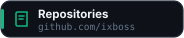
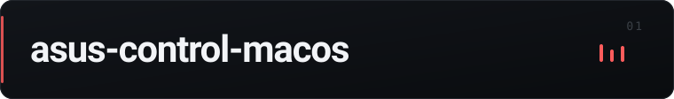
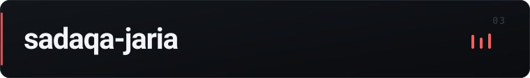
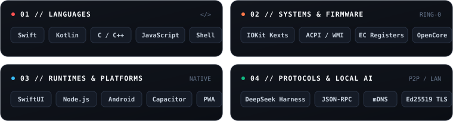

  <picture>
    <source media="(prefers-color-scheme: dark)" srcset="assets/hero.svg">
    <source media="(prefers-color-scheme: light)" srcset="assets/hero-light.svg">
    
  </picture>

  &nbsp;
  &nbsp;
  &nbsp;
  

  <picture>
    <source media="(prefers-color-scheme: dark)" srcset="assets/divider.svg">
    <source media="(prefers-color-scheme: light)" srcset="assets/divider-light.svg">
    
  </picture>

## Selected Work

  <a href="https://github.com/ixboss/asus-control-macos">
    <picture>
      <source media="(prefers-color-scheme: dark)" srcset="assets/projects/asus-control-macos.svg">
      <source media="(prefers-color-scheme: light)" srcset="assets/projects/asus-control-macos-light.svg">
      
    </picture>
  </a>

> A native macOS app that controls ASUS ROG & TUF laptop hardware — custom fan curves, battery charge limits, thermal profiles, and CPU power limits. Built for Hackintosh setups where Armoury Crate isn't an option. Current release: **v0.4.0**.
>
> 
> 
> 
> &nbsp;·&nbsp; [**Repository →**](https://github.com/ixboss/asus-control-macos) · [**Latest Release →**](https://github.com/ixboss/asus-control-macos/releases)

 

  <a href="https://github.com/ixboss/universal-harness">
    <picture>
      <source media="(prefers-color-scheme: dark)" srcset="assets/projects/universal-harness.svg">
      <source media="(prefers-color-scheme: light)" srcset="assets/projects/universal-harness-light.svg">
      
    </picture>
  </a>

> A portable runtime for AI coding harnesses — DeepSeek, OmniRoute, Claude Code, and Gemini CLI. Runs from a USB stick or desktop, with an Android app that either controls the machine over LAN or runs the harness on the phone itself.
>
> 
> 
> 
> &nbsp;·&nbsp; [**Repository →**](https://github.com/ixboss/universal-harness)

 

  <a href="https://ixboss.github.io/sadaqa-jaria/">
    <picture>
      <source media="(prefers-color-scheme: dark)" srcset="assets/projects/sadaqa-jaria.svg">
      <source media="(prefers-color-scheme: light)" srcset="assets/projects/sadaqa-jaria-light.svg">
      
    </picture>
  </a>

> A free, offline-capable Quran PWA built as Sadaqah Jariyah — the full Mushaf, tafsir, recitations, khatmah tracking, and daily adhkar, all stored locally on your device. No accounts, no tracking, no ads.
>
> 
> 
> 
> 
> &nbsp;·&nbsp; [**Launch Web App →**](https://ixboss.github.io/sadaqa-jaria/) · [**Repository →**](https://github.com/ixboss/sadaqa-jaria)

  <picture>
    <source media="(prefers-color-scheme: dark)" srcset="assets/divider.svg">
    <source media="(prefers-color-scheme: light)" srcset="assets/divider-light.svg">
    
  </picture>

## Stack & Architecture

  <picture>
    <source media="(prefers-color-scheme: dark)" srcset="assets/stack.svg">
    <source media="(prefers-color-scheme: light)" srcset="assets/stack-light.svg">
    
  </picture>

  <picture>
    <source media="(prefers-color-scheme: dark)" srcset="assets/divider.svg">
    <source media="(prefers-color-scheme: light)" srcset="assets/divider-light.svg">
    
  </picture>

## Activity

  <picture>
    <source media="(prefers-color-scheme: dark)" srcset="assets/snake/snake-dark.svg">
    <source media="(prefers-color-scheme: light)" srcset="assets/snake/snake-light.svg">
    
  </picture>

