  <picture>
    <source media="(prefers-color-scheme: dark)" srcset="assets/boss.svg">
    <source media="(prefers-color-scheme: light)" srcset="assets/boss-light.svg">
    
  </picture>

  <a href="mailto:hossam.m.ghareeb@gmail.com"><picture><source media="(prefers-color-scheme: dark)" srcset="assets/badges/email.svg"><source media="(prefers-color-scheme: light)" srcset="assets/badges/email-light.svg"></picture></a>&nbsp;
  <a href="https://www.tiktok.com/@ixbossss"><picture><source media="(prefers-color-scheme: dark)" srcset="assets/badges/tiktok.svg"><source media="(prefers-color-scheme: light)" srcset="assets/badges/tiktok-light.svg"></picture></a>&nbsp;
  <a href="https://www.instagram.com/ixbosss"><picture><source media="(prefers-color-scheme: dark)" srcset="assets/badges/instagram.svg"><source media="(prefers-color-scheme: light)" srcset="assets/badges/instagram-light.svg"></picture></a>&nbsp;
  <a href="https://github.com/ixboss?tab=repositories"><picture><source media="(prefers-color-scheme: dark)" srcset="assets/badges/github.svg"><source media="(prefers-color-scheme: light)" srcset="assets/badges/github-light.svg"></picture></a>

  <picture>
    <source media="(prefers-color-scheme: dark)" srcset="assets/divider.svg">
    <source media="(prefers-color-scheme: light)" srcset="assets/divider-light.svg">
    
  </picture>

## `[ 01 — SYSTEMS & CODE ]`

  <a href="https://github.com/ixboss/asus-control-macos">
    <picture>
      <source media="(prefers-color-scheme: dark)" srcset="assets/projects/asus-control-macos.svg">
      <source media="(prefers-color-scheme: light)" srcset="assets/projects/asus-control-macos-light.svg">
      
    </picture>
  </a>

> A native macOS app that controls ASUS ROG &amp; TUF laptop hardware — custom fan curves, battery charge limits, thermal profiles, and CPU power limits. Built for Hackintosh setups where Armoury Crate isn't an option.
>
> 
> 
> 

  <picture>
    <source media="(prefers-color-scheme: dark)" srcset="assets/projects/bossmax.svg">
    <source media="(prefers-color-scheme: light)" srcset="assets/projects/bossmax-light.svg">
    
  </picture>

> Private cross-platform Flutter app engineered to boost export clarity and bypass TikTok &amp; Instagram Reels compression — featuring a Liquid Glass UI, bilingual AR/EN support, proprietary media optimization, and Ed25519-signed offline licensing.
>
> 
> 
> 

  <a href="https://github.com/ixboss/universal-harness">
    <picture>
      <source media="(prefers-color-scheme: dark)" srcset="assets/projects/universal-harness.svg">
      <source media="(prefers-color-scheme: light)" srcset="assets/projects/universal-harness-light.svg">
      
    </picture>
  </a>

> A portable runtime for AI coding harnesses — DeepSeek, OmniRoute, Claude Code, and Gemini CLI. Runs from a USB stick or desktop, with an Android app that either controls the machine over LAN or runs the harness on the phone itself.
>
> 
> 
> 

  <a href="https://ixboss.github.io/sadaqa-jaria/">
    <picture>
      <source media="(prefers-color-scheme: dark)" srcset="assets/projects/sadaqa-jaria.svg">
      <source media="(prefers-color-scheme: light)" srcset="assets/projects/sadaqa-jaria-light.svg">
      
    </picture>
  </a>

> A free, offline-capable Quran PWA built as Sadaqah Jariyah — the full Mushaf, tafsir, recitations, khatmah tracking, and daily adhkar, all stored locally on your device. No accounts, no tracking, no ads.
>
> 
> 
> 
> 

  <picture>
    <source media="(prefers-color-scheme: dark)" srcset="assets/divider.svg">
    <source media="(prefers-color-scheme: light)" srcset="assets/divider-light.svg">
    
  </picture>

## `[ 02 — TECH CONSTELLATION ]`

  <picture>
    <source media="(prefers-color-scheme: dark)" srcset="assets/stack.svg">
    <source media="(prefers-color-scheme: light)" srcset="assets/stack-light.svg">
    
  </picture>

## `[ 03 — BEYOND CODE // ESPORTS ]`

  <a href="https://liquipedia.net/pubgmobile/Boss_(Egyptian_player)">
    <picture>
      <source media="(prefers-color-scheme: dark)" srcset="assets/esports.svg">
      <source media="(prefers-color-scheme: light)" srcset="assets/esports-light.svg">
      
    </picture>
  </a>

  <a href="https://liquipedia.net/pubgmobile/Boss_(Egyptian_player)">ForKill Esports · PMNC Egypt 2026 Spring Champion — verified on Liquipedia ↗</a>

  <picture>
    <source media="(prefers-color-scheme: dark)" srcset="assets/divider.svg">
    <source media="(prefers-color-scheme: light)" srcset="assets/divider-light.svg">
    
  </picture>

## Activity

  <picture>
    <source media="(prefers-color-scheme: dark)" srcset="assets/snake/snake-dark.svg">
    <source media="(prefers-color-scheme: light)" srcset="assets/snake/snake-light.svg">
    
  </picture>

