  <a href="https://ixboss.vercel.app">
    <picture>
      <source media="(prefers-color-scheme: dark)" srcset="assets/boss.svg">
      <source media="(prefers-color-scheme: light)" srcset="assets/boss-light.svg">
      
    </picture>
  </a>

  <a href="https://ixboss.vercel.app"><picture><source media="(prefers-color-scheme: dark)" srcset="assets/badges/portfolio.svg"><source media="(prefers-color-scheme: light)" srcset="assets/badges/portfolio-light.svg"></picture></a>&nbsp;
  <a href="https://www.linkedin.com/in/hossam-mohamed-7932b0379"><picture><source media="(prefers-color-scheme: dark)" srcset="assets/badges/linkedin.svg"><source media="(prefers-color-scheme: light)" srcset="assets/badges/linkedin-light.svg"></picture></a>&nbsp;
  <a href="mailto:hossam.m.ghareeb@gmail.com"><picture><source media="(prefers-color-scheme: dark)" srcset="assets/badges/email.svg"><source media="(prefers-color-scheme: light)" srcset="assets/badges/email-light.svg"></picture></a>

<!-- AUTO:BUILDING:START -->

  <a href="https://ixboss.vercel.app/?project=sadaqa-jaria">
    <picture>
      <source media="(prefers-color-scheme: dark)" srcset="assets/building-now.svg">
      <source media="(prefers-color-scheme: light)" srcset="assets/building-now-light.svg">
      
    </picture>
  </a>

<!-- AUTO:BUILDING:END -->

  <picture>
    <source media="(prefers-color-scheme: dark)" srcset="assets/divider.svg">
    <source media="(prefers-color-scheme: light)" srcset="assets/divider-light.svg">
    
  </picture>

## `[ 01 — SYSTEMS & CODE ]`

<!-- AUTO:PROJECTS:START -->

  <a href="https://ixboss.vercel.app/?project=sadaqa-jaria">
    <picture>
      <source media="(prefers-color-scheme: dark)" srcset="assets/projects/sadaqa-jaria.svg">
      <source media="(prefers-color-scheme: light)" srcset="assets/projects/sadaqa-jaria-light.svg">
      
    </picture>
  </a>

> A free Islamic companion app that works with no internet at all: the complete 604-page Quran with offline commentary, accurate prayer times, Adhkar, and reading plans — installable on web, iOS, Android, and desktop.
>
> `Vanilla JavaScript` · `Offline-First PWA` · `Service Worker + IndexedDB` — [Case Study ↗](https://ixboss.vercel.app/?project=sadaqa-jaria) · [Live App ↗](https://ixboss.github.io/sadaqa-jaria/) · [GitHub Repo ↗](https://github.com/ixboss/sadaqa-jaria) · **Status:** Active

  <a href="https://ixboss.vercel.app/?project=asus-control-macos">
    <picture>
      <source media="(prefers-color-scheme: dark)" srcset="assets/projects/asus-control-macos.svg">
      <source media="(prefers-color-scheme: light)" srcset="assets/projects/asus-control-macos-light.svg">
      
    </picture>
  </a>

> Full fan, thermal, and power control for ASUS TUF &amp; ROG laptops running macOS — custom fan curves, switchable power modes, and live temperature readings, all from a native menu bar app.
>
> `Swift` · `IOKit` · `macOS Kernel Extension (C++)` — [Case Study ↗](https://ixboss.vercel.app/?project=asus-control-macos) · [GitHub Repo ↗](https://github.com/ixboss/asus-control-macos) · **★ 6 Stars**

  <a href="https://ixboss.vercel.app/?project=bossmax">
    <picture>
      <source media="(prefers-color-scheme: dark)" srcset="assets/projects/bossmax.svg">
      <source media="(prefers-color-scheme: light)" srcset="assets/projects/bossmax-light.svg">
      
    </picture>
  </a>

> Cross-platform Flutter mobile application for preparing high-clarity social video exports with platform-tuned presets for TikTok and Instagram Reels, one-tap workflows, a bilingual Arabic/English interface, and offline execution.
>
> `Flutter` · `Dart` · `Video Encoding` — [Case Study ↗](https://ixboss.vercel.app/?project=bossmax) · **Status:** Private Product Build

  <a href="https://ixboss.vercel.app/?project=universal-harness">
    <picture>
      <source media="(prefers-color-scheme: dark)" srcset="assets/projects/universal-harness.svg">
      <source media="(prefers-color-scheme: light)" srcset="assets/projects/universal-harness-light.svg">
      
    </picture>
  </a>

> Portable TypeScript/Node.js runtime for running AI coding CLIs from a USB drive or desktop host without local installation, paired with an encrypted local-network bridge to an Android companion.
>
> `TypeScript` · `Node.js` · `Android / Kotlin` — [Case Study ↗](https://ixboss.vercel.app/?project=universal-harness) · [GitHub Repo ↗](https://github.com/ixboss/universal-harness) · **Status:** Active
<!-- AUTO:PROJECTS:END -->

  <picture>
    <source media="(prefers-color-scheme: dark)" srcset="assets/divider.svg">
    <source media="(prefers-color-scheme: light)" srcset="assets/divider-light.svg">
    
  </picture>

## `[ 02 — TECH CONSTELLATION ]`

  <picture>
    <source media="(prefers-color-scheme: dark)" srcset="assets/stack.svg">
    <source media="(prefers-color-scheme: light)" srcset="assets/stack-light.svg">
    
  </picture>

## `[ 03 — BEYOND CODE // ESPORTS ]`

  <a href="https://liquipedia.net/pubgmobile/Boss_(Egyptian_player)">
    <picture>
      <source media="(prefers-color-scheme: dark)" srcset="assets/esports.svg">
      <source media="(prefers-color-scheme: light)" srcset="assets/esports-light.svg">
      
    </picture>
  </a>

  <a href="https://liquipedia.net/pubgmobile/Boss_(Egyptian_player)">PMNC Egypt 2026 Spring Champion · Competitive PUBG Mobile — verified on Liquipedia ↗</a>

  <a href="https://www.tiktok.com/@ixbossss"><picture><source media="(prefers-color-scheme: dark)" srcset="assets/badges/tiktok.svg"><source media="(prefers-color-scheme: light)" srcset="assets/badges/tiktok-light.svg"></picture></a>&nbsp;
  <a href="https://www.instagram.com/ixbosss"><picture><source media="(prefers-color-scheme: dark)" srcset="assets/badges/instagram.svg"><source media="(prefers-color-scheme: light)" srcset="assets/badges/instagram-light.svg"></picture></a>

  <picture>
    <source media="(prefers-color-scheme: dark)" srcset="assets/divider.svg">
    <source media="(prefers-color-scheme: light)" srcset="assets/divider-light.svg">
    
  </picture>

## Activity

  <picture>
    <source media="(prefers-color-scheme: dark)" srcset="assets/snake/snake-dark.svg">
    <source media="(prefers-color-scheme: light)" srcset="assets/snake/snake-light.svg">
    
  </picture>

